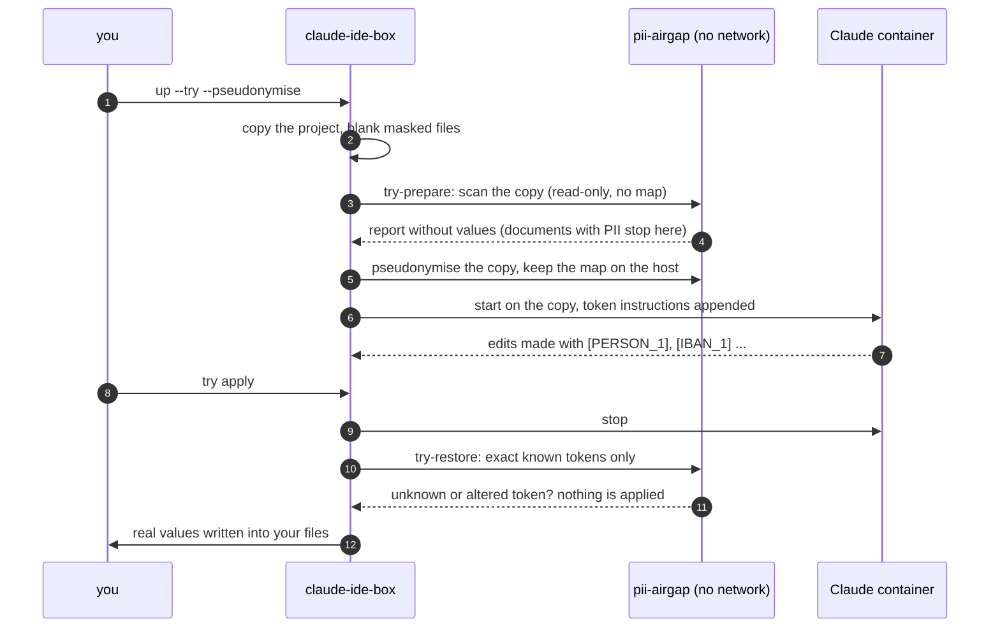

<h1 align="center">pii-airgap</h1>

<p align="center">
  <b>Air-gapped PII detector and reversible anonymiser for AI coding agents and document work.</b><br>
  Finds personal data in a project and swaps it for tokens before an AI agent sees it - on your machine, with a local model and no network.
</p>

<p align="center">
  <a href="https://github.com/PiotrSitkowski/pii-airgap/actions/workflows/ci.yml"></a>
  <a href="LICENSE"></a>
  
  
  
</p>

<p align="center">
  <picture>
    <source media="(prefers-color-scheme: dark)" srcset="docs/assets/architecture-dark.svg">
    
  </picture>
</p>

---

**What it is.** A scanner and a reversible pseudonymiser that run entirely on your machine. `scan`
tells you which files hold which kinds of personal data. For an agent session, pii-airgap replaces
names, account numbers and identifiers in a *copy* of the project with tokens such as `[PERSON_1]`
or `[IBAN_1]`, keeps the token map on the host, and puts the real values back before the agent's
changes reach your files. Detection uses checksums, patterns, your own lists and a local NER model
that is baked into the image when it is built. A native plugin for
[Claude IDE Box](https://github.com/PiotrSitkowski/claude-ide-box), and usable on its own with plain
`docker run --network none`.

**What it is not.** It is not a guarantee and not a compliance tool. Read the warning below before
relying on it.

> [!WARNING]
> **No detector finds all personal data.** Whatever pii-airgap misses is sent to the AI provider in
> clear text, exactly as without it. It reduces exposure; it does not make a workflow compliant
> with GDPR, CCPA, HIPAA or any other regulation, and it is not a substitute for a data protection
> assessment, a processing agreement with the provider, or not sending the data at all.

## Contents

- [What it does](#what-it-does)
- [How detection works](#how-detection-works) - [measured quality](#measured-quality)
- [Quick start](#quick-start) - [on its own](#on-its-own) · [with Claude IDE Box](#with-claude-ide-box)
- [Telling the agent that tokens are immutable](#telling-the-agent-that-tokens-are-immutable)
- [Security model](#security-model)
- [Documentation](#documentation)

## What it does

| Command | What it does |
|---|---|
| `pii-airgap scan` | which files hold which kinds of personal data, with a confidence per finding. Plain text, DOCX/XLSX/PPTX, OpenDocument, PDF, scans (OCR in Polish, English and German) and legacy Office formats. Cached by file content hash; neither the cache nor the report ever contains a detected value - only type, line, confidence and a masked preview |
| `pii-airgap mask-add FILE...` | adds files to Claude IDE Box's masks for the project (in `~/.config/claude-ide-box/projects/<container>.conf`, never in the project), so the agent's container sees them as empty files |
| `pii-airgap anonymise` / `restore` | replaces values with `[TYPE_N]` tokens in a copy and puts them back later. The token map stays on the host (mode 600) and is never mounted into the agent's container. Restoration is strict: only exact, known tokens are replaced; unknown or altered tokens are reported and nothing is guessed |
| `pii-airgap try-prepare` / `try-restore` | the same for the copy of a `claude-ide-box up --try` session |

Everything runs in a throw-away container with `--network none`, a read-only root file system, no
capabilities and your UID. The model is part of the image; at run time nothing can be downloaded or
sent anywhere. CPU only. The image is 0.9-1.4 GB without GLiNER (measured, see
[TESTING.md](TESTING.md)), so it is an optional add-on and never part of the Claude IDE Box base image.

> [!NOTE]
> Internet access is needed only to **build** the image (Ubuntu packages, Python packages, the model
> from GitHub releases or Hugging Face). Once built, the image works on a machine with no network.

## How detection works

Three layers, no single technique:

| Layer | Finds | Precision | Recall |
|---|---|---|---|
| Checksums | IBAN (mod 97), payment cards (Luhn + issuer prefix), PESEL (with date), NIP, REGON, Polish ID card and passport, German Steuer-ID, Spanish DNI/NIE, Italian codice fiscale, French NIR, Dutch BSN, Swedish personnummer, Finnish HETU, Belgian national number; US SSN (format rules - it has no check digit) | very high | high for the formats it knows |
| Patterns with context | e-mail, phone numbers (international format, or a local number after "tel."), dates of birth (a date after "ur.", "born", "geb."...), street addresses and Polish postcodes | high | depends on how the text is written |
| Tables | every cell of a column whose header names a person (`name`, `Imię i nazwisko`, `Nachname`...), a place or an address - CSV, TSV, XLSX and Markdown tables | high | the whole column |
| Legal forms | a run of capitalised words before `Sp. z o.o.`, `S.A.`, `GmbH`, `KG`, `Ltd`, `LLP`, `Inc.`... is one organisation | high | companies with a legal form |
| Your lists | client names, project code names - `~/.config/pii-airgap/lists/*.txt`, one `term` or `TYPE: term` per line | exact | exactly what you list |
| NER model | names, organisations, places | see below | see below |

Weak checksums (NIP, REGON, BSN, ID card and passport numbers, Steuer-ID) only count when a context
word is nearby ("NIP", "REGON", "BSN", "dowód"...), because about one random number in ten passes
them. Lists live outside any scanned folder: an agent that can edit the project must not be able
to edit what is looked for.

### Measured quality

On a synthetic labelled corpus (230 documents: Polish 83, English 74, German 73; every name,
company and number is invented - [eval/](eval/)). A prediction counts when it overlaps a labelled
entity of the same type. "Masked" is the share of labelled characters covered by any finding, i.e.
what pseudonymisation would actually hide.

With the default image (spaCy `xx_ent_wiki_sm`):

| Type | Labelled | Found | False positives | Precision % | Recall % |
|---|---:|---:|---:|---:|---:|
| PERSON | 170 | 165 | 25 | 86.8 | 97.1 |
| ORG | 84 | 63 | 10 | 86.3 | 75.0 |
| LOCATION | 107 | 105 | 30 | 77.8 | 98.1 |
| ADDRESS | 53 | 48 | 0 | 100.0 | 90.6 |
| DOB | 32 | 32 | 0 | 100.0 | 100.0 |
| EMAIL | 41 | 41 | 0 | 100.0 | 100.0 |
| PHONE | 39 | 36 | 0 | 100.0 | 92.3 |
| IBAN | 26 | 25 | 0 | 100.0 | 96.2 |
| CARD | 19 | 19 | 0 | 100.0 | 100.0 |
| PESEL / NIP / REGON / ID card | 7 / 6 / 6 / 6 | 6 / 6 / 6 / 6 | 0 | 100.0 | 85.7 / 100 / 100 / 100 |
| SSN / TAXID | 7 / 7 | 6 / 7 | 0 | 100.0 | 85.7 / 100 |

| Language | Precision % | Recall % | Masked characters % |
|---|---:|---:|---:|
| Polish | 86.9 | 93.2 | 96.1 |
| English | 93.4 | 93.9 | 97.5 |
| German | 89.6 | 93.8 | 95.6 |

Without a model (`NER=none`) names, organisations and places are only found through your lists,
table headers and legal forms: masked characters drop to 64 % (Polish), 54 % (English) and 59 %
(German); everything else is unchanged ([eval/results-none.md](eval/results-none.md)).

**GLiNER** (`pii-airgap build --ner gliner`, model `urchade/gliner_multi-v2.1`), measured by CI
inside the image without network ([eval/results-gliner-urchade-gliner_multi-v2.1.md](eval/results-gliner-urchade-gliner_multi-v2.1.md)):

| Backend | Masked % Polish | Masked % English | Masked % German | ORG recall % | PERSON recall % | Time per document |
|---|---:|---:|---:|---:|---:|---:|
| spaCy `xx_ent_wiki_sm` (default) | 96.1 | 97.5 | 95.6 | 75.0 | 97.1 | 2.5 ms |
| GLiNER `gliner_multi-v2.1` | 98.5 | 99.0 | 98.5 | 92.9 | 100.0 | 226 ms |

GLiNER finds more, mostly organisations, at about 90 times the CPU time, and its "date of birth"
label marks ordinary dates too (14 false positives). It is not the default yet only because the
licence of its weights has not been checked on the model card (see [docs/MODELS.md](docs/MODELS.md)).

**Cases from the first end-to-end test.** Fifteen documents in the corpus reproduce, with invented
data, what a first run with Claude IDE Box let through: names in table columns with no sentence
around them, a first name left next to a token, company names with a legal form, a capitalised
first word taken for a place. Each was turned into a rule (below), measured before and after:

| | Values fully masked | Partly | Missed | False findings |
|---|---:|---:|---:|---:|
| spaCy, before the rules | 31 / 42 | 4 | 7 | 2 |
| spaCy, with the rules | **42 / 42** | 0 | 0 | 0 |
| GLiNER, before the rules | 41 / 42 | 1 | 0 | 1 |
| GLiNER, with the rules | **42 / 42** | 0 | 0 | 1 |

The rules matter most for the small model; GLiNER needed them only for one legal form. They are:
table columns whose header names a person, place or address (CSV, TSV, XLSX, Markdown tables);
a model's person match widened over adjacent capitalised words, titles left outside; a run of
capitalised words before a legal form (Sp. z o.o., S.A., GmbH, Ltd, ...) as one organisation; a
one-word place at the start of a sentence dropped when the model no longer finds it in lower case;
and a model's matches cut at line breaks. With spaCy they cost some precision on people (90.2 % ->
86.8 %): a match that spanned two lines is now two findings, one of them a label such as "Telefon".

**How to read these numbers.** The templates were written by the same person as the rules, so the
checksum and pattern rows are optimistic: every miss in those rows comes from the handful of
"hard" sentences that were added afterwards without tuning the rules (a lower-case IBAN, a PESEL
with a stray space, an SSN without dashes, a UK mobile number, a German postcode, an inflected
Polish street name). Real documents will do worse. The NER rows are a fairer picture of the model,
but the corpus is small and synthetic. One known trade-off of the sentence-start rule: a city that
opens a sentence and that the model only recognises with its capital letter is not masked.

## Quick start

### On its own

```sh
docker build -f image/Dockerfile -t pii-airgap .          # NER=spacy by default
docker run --rm --network none --read-only --tmpfs /tmp \
  --cap-drop ALL --security-opt no-new-privileges --user "$(id -u):$(id -g)" \
  -v "$PWD:$PWD:ro" pii-airgap scan "$PWD" --no-cache
```

or with the wrapper, which adds the cache, your lists and every isolation flag:

```sh
ln -s "$PWD/bin/pii-airgap" ~/.local/bin/pii-airgap
pii-airgap build                      # --ner gliner | spacy | none
cd ~/work/some-project && pii-airgap scan
pii-airgap scan --json > report.json  # machine-readable; --fail-on-pii exits 3 when anything is found
```

Pseudonymise a copy and restore it later (in place - never run it on your only copy):

```sh
cp -R project /tmp/project-copy
pii-airgap anonymise /tmp/project-copy --map ~/private/project.map.json --git strip
# ... work on /tmp/project-copy ...
pii-airgap restore /tmp/project-copy --map ~/private/project.map.json --base project
```

`anonymise` refuses (exit 3, nothing changed) when it would be unsafe: git metadata (its history
holds the original values and cannot be rewritten), a document with personal data that it cannot
rewrite in place (DOCX, PDF, scans... - mask or remove those), personal data in a file name, a
non-UTF-8 text file that seems to hold personal data, or text that already looks like a token.

### With Claude IDE Box

```sh
pii-airgap scan                         # what is in this project?
pii-airgap mask-add docs/contract.docx  # hide documents completely
claude-ide-box up --recreate            # masks apply when the container is created
```

Pseudonymised sessions build on Claude IDE Box's `up --try` mode (Claude works on a copy of the
project). The hooks below are proposed for Claude IDE Box ([PR #3](https://github.com/PiotrSitkowski/claude-ide-box/pull/3)) and not merged yet; until then the two
steps can be run by hand around a try session (`pii-airgap try-prepare DIR` right after the copy is
made and before the container starts, `pii-airgap try-restore DIR` before `try apply`):



A failed `try-prepare` stops the session before the container starts; a failed `try-restore` stops
`apply` and leaves your files untouched.

## Telling the agent that tokens are immutable

The wrapper appends `pii-airgap system-prompt` to the agent's system prompt (Claude Code:
`--append-system-prompt`). In short: copy `[TYPE_N]` tokens character for character, never invent,
inflect, split, translate or decode them, never write code that parses them, and use obviously
fictional data that does not look like a token when examples are needed.

> [!WARNING]
> **What can still go wrong, even with that prompt.**
> - **Altered tokens** - `[person_1]`, `[PERSON 1]`, `PERSON_1`, escaped brackets in a regex or JSON
>   string. Restoration reports them (file and line) and writes nothing until you fix them or pass
>   `--keep-unresolved`.
> - **Invented tokens** - `[PERSON_7]` that was never issued. Reported as unknown, never guessed.
> - **Valid tokens in the wrong place** - the agent copies `[PERSON_1]` into a log message, a test
>   fixture or a commit message. It is a known token, so it is restored there, and the real value ends
>   up in a new place. Review the diff (`try diff` shows the restored text).
> - **Meaning lost** - Polish inflection (`Kowalski` / `Kowalskiego` are different tokens), the
>   agent cannot see that two tokens are the same person, cannot check a checksum, compute an age
>   from a date of birth or validate a format. Code that depends on real values has to be tested on
>   the host, after restoration.
> - **Misses** - anything not detected stays in clear text in the copy and is sent to the provider.
> - **Things outside the copy** - the agent's own conversation history, prompts you type, files you
>   paste into the chat and tool output from allowlisted network services are not pseudonymised.

## Security model

| Threat | How pii-airgap handles it |
|---|---|
| a malicious PDF or Office file exploits a parser | the scanner has no network, no token map, the project read-only, no capabilities, your UID, memory and process limits |
| the token map leaks to the agent | it lives in `~/.local/state/pii-airgap/` (directory 700, file 600) and is never mounted into the agent's container or the scanner |
| the agent edits what is looked for | your lists must live outside every scanned folder |
| a document cannot be pseudonymised | DOCX, PDF and scans with personal data stop the session until they are masked |
| git history keeps the original values | `.git` is refused, or removed from the copy in a try session |
| a model fails to load and finds nothing | the run fails; a missing model never turns into "no names found" |
| a token restores to the wrong value | exact match only; near misses are reported and nothing is written |

A compromised scanner could still lie and report "no PII" - the same outcome as a miss, stated
above. It cannot reach the network or the map.

More: [SECURITY.md](SECURITY.md), [docs/DESIGN.md](docs/DESIGN.md).

## Documentation

- [docs/DESIGN.md](docs/DESIGN.md) - architecture, data flow, decisions
- [docs/MODELS.md](docs/MODELS.md) - NER candidates, licences, languages, what was verified
- `tools/make-diagrams.py` - regenerates the architecture diagrams (light and dark)
- [TESTING.md](TESTING.md) - what is tested, where, and what is not
- [CONTRIBUTING.md](CONTRIBUTING.md)

## Licence

Apache License 2.0, see [LICENSE](LICENSE). Models and tools installed into the image keep their own
licences (spaCy and `xx_ent_wiki_sm`: MIT, trained on WikiNER, CC BY 4.0; GLiNER: see
[docs/MODELS.md](docs/MODELS.md); LibreOffice: MPL 2.0; poppler: GPL; Tesseract: Apache 2.0).
