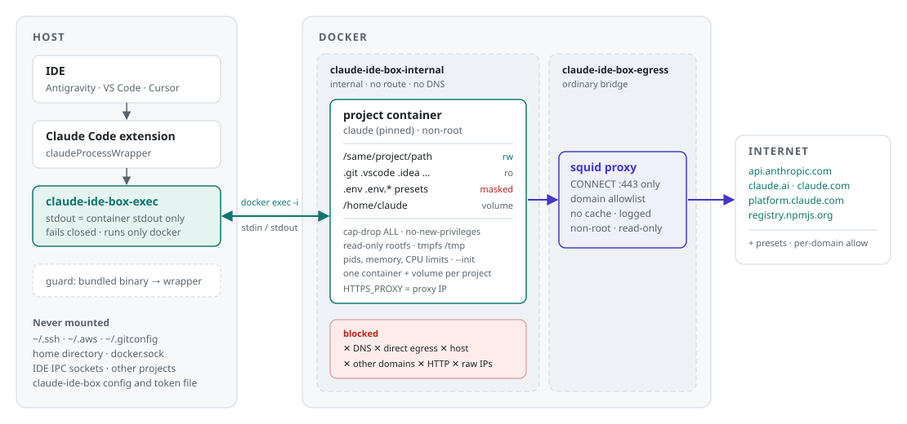

<h1 align="center">Claude IDE Box</h1>

<p align="center">
  <b>The Claude Code IDE extension, with Claude Code itself locked in a container.</b><br>
  It sees only the current project and reaches only the domains you allow.
</p>

<p align="center">
  <a href="https://github.com/PiotrSitkowski/claude-ide-box/actions/workflows/ci.yml"></a>
  <a href="LICENSE"></a>
  
  
</p>

<p align="center">
  <picture>
    <source media="(prefers-color-scheme: dark)" srcset="docs/assets/architecture-dark.svg">
    
  </picture>
</p>

---

**What it is.** A small set of shell scripts that sit between the official Claude Code extension
(`anthropic.claude-code`, in Antigravity, VS Code or Cursor) and the `claude` process it starts.
You keep using the extension panel as usual - chat, diffs, permission prompts, resumed
conversations - but `claude` runs inside a per-project Docker container with no capabilities, a
read-only root filesystem, no DNS and no route to the internet except an allowlisting proxy.
The container sees the project directory and nothing else of your machine.

**What it is not.** It is not a Dev Container, not a VM, and not a full answer to "AI agent
security". Claude can still change every file in the project, and anything you later *run on the
host* from that project runs with your privileges. Read the [threat model](#threat-model) before
relying on it.

## Contents

- [How it works](#how-it-works)
- [Threat model](#threat-model)
- [Install](#install) - [macOS](#macos) · [Linux](#linux) · [Windows with WSL2](#windows-with-wsl2)
- [Daily use](#daily-use)
- [What runs in the box](#what-runs-in-the-box) - [dev servers](#dev-servers-react-vite-next-django-) · [office documents](#office-documents)
- [Modules](#modules)
- [Network allowlist](#network-allowlist)
- [Configuration](#configuration)
- [Updating Claude Code](#updating-claude-code)
- [Troubleshooting](#troubleshooting)
- [Uninstall](#uninstall)
- [Development](#development)

## How it works

The extension has a setting, `claudeCode.claudeProcessWrapper`, that names an executable to launch
instead of its bundled `claude` binary. claude-ide-box sets it to `claude-ide-box-exec`, which does
nothing but `docker exec -i` into the project's container and run `claude` there with the same
arguments. stdin/stdout - the extension's stream-json protocol - is the only channel between the
host and the container.


| Piece | What it does |
|---|---|
| `bin/claude-ide-box-exec` | The wrapper the extension runs. Writes nothing to stdout but the container's stdout, logs to `~/.local/state/claude-ide-box/wrapper.log`, never executes anything on the host except `docker`. |
| `bin/claude-ide-box` | Management CLI: `setup`, `login`, `up`, `down`, `rm`, `shell`, `status`, `logs`, `allow`, `preset`, `guard`, `doctor`. |
| `image/` | Debian bookworm + Node 22 + a pinned Claude Code. Non-root user with your UID/GID, no sudo. Optional language profiles (`php` ships). |
| `proxy/` | squid as an unprivileged user: CONNECT to port 443 of allowlisted domains only, no cache, every denial logged. |
| Networks | `claude-ide-box-internal` (`--internal`, no route out, host gets no address on it) and `claude-ide-box-egress` (only the proxy is on it). |
| `guard` | Replaces the binary bundled with every installed extension version by a symlink to the wrapper, so even an extension that ignores the wrapper setting lands in the container. |

The first start creates the read-only directories that do not exist yet (`.git`, `.vscode`,
`.idea`, `.agent`, `.agents`, `.devcontainer`, `.claude`) as empty directories owned by you;
otherwise Claude could create them writable. Git ignores an empty `.git` directory, and `git init` on the host
fills it normally.

One container and one home volume exist **per project** (`claude-ide-box-<name>-<hash>`), so hooks,
settings and history in one project's `~/.claude` never touch another project.

## Threat model

Claude IDE Box assumes that whatever runs inside the container - Claude, a tool it calls, a
dependency it installs, a prompt-injected instruction - may be hostile, and keeps it away from the
rest of your machine.

| Inside the container, Claude **cannot** | How |
|---|---|
| read `~/.ssh`, `~/.aws`, `~/.gitconfig`, other projects, your home | only the project directory is mounted; home and `docker.sock` never are |
| read `.env`, `.env.*` (and PrestaShop config with the preset) | bind-mounted over with an empty read-only file / empty tmpfs |
| plant git hooks, IDE tasks or Claude Code hooks | `.git` (at every depth), `.vscode`, `.idea`, `.agent`, `.agents`, `.devcontainer`, `.claude` are read-only |
| unmask a secret by renaming or replacing it | masked paths are recorded with their inode; a moved or swapped one stops the next start |
| smuggle mount options through file names | paths with commas, quotes or control characters stop the start instead of reaching `docker --mount` |
| reach arbitrary hosts | no route out; the proxy allows only CONNECT :443 to listed domains |
| exfiltrate over DNS | no resolver; the proxy resolves names, the container never does |
| reach services on your host or LAN | internal network; the host has no address on that bridge |
| escalate inside the container | non-root, `--cap-drop ALL`, `no-new-privileges`, read-only rootfs |
| use your IDE's connection | no IDE WebSocket, IPC socket or credential helper is bridged in |

> [!WARNING]
> **Limits - stated plainly.**
> - **Claude can modify every project file.** Anything the *host* later executes from the project
>   runs outside the sandbox: `composer`/`npm` scripts, `Makefile`, `.envrc` (direnv), Husky hooks,
>   test suites, CI after you push. Review changes before running them on the host.
> - **Every allowlisted domain is an exfiltration channel.** `api.anthropic.com` is unavoidable.
>   The `github` preset in particular lets anything with a token push data out.
> - **Conversation history lives in the container's volume**, not in your `~/.claude`. Removing it
>   (`claude-ide-box rm --volume`) deletes that history.
> - **`CLAUDE.md` stays writable.** A `CLAUDE.md` that Claude writes is read as instructions by any
>   later Claude Code session, also one on the host: a risk of injecting instructions into the
>   model, not of executing code (hooks, which do execute, live in the read-only `.claude`).
> - **A repository Claude creates mid-session is writable until the next start.** Then its `.git`
>   becomes read-only. Until then, only the IDE setting `"git.autoRepositoryDetection": false`
>   keeps the host from running git (hooks, `core.fsmonitor`) in it; `doctor` warns without it.
> - **Containers of different projects share the internal network** and can reach each other's
>   listening ports. Nothing listens by default; see [SECURITY.md](SECURITY.md#known-limitations).
> - **The extension is trusted.** It runs on the host and renders what the container sends.
>   Claude IDE Box protects the host from the `claude` process, not from the extension.
> - **Docker is the boundary.** A container escape (kernel or runtime bug) defeats all of this.

## Install

Prerequisites on every platform: Docker (Desktop or Engine), `git`, and the Claude Code extension
in your IDE. A Claude subscription (Pro/Max) is the primary path; an API key works too.

```bash
git clone https://github.com/PiotrSitkowski/claude-ide-box.git
```

```bash
cd claude-ide-box && ./install.sh
```

`install.sh` copies the scripts to `~/.local/share/claude-ide-box`, links `claude-ide-box` and
`claude-ide-box-exec` into `~/.local/bin`, needs no root, and is safe to re-run. It prints the exact
settings snippet for your machine.

### macOS

The reference platform is macOS 15 on Intel with Docker Desktop (see the manual checklist in
[TESTING.md](TESTING.md)); Apple Silicon builds the same images natively for arm64.

1. Start Docker Desktop. The default file sharing (`/Users`, `/Volumes`, `/private`, `/tmp`)
   covers usual project locations.
2. Install and build:
   ```bash
   ./install.sh && claude-ide-box setup
   ```
3. Get a token (opens a URL you visit in your browser):
   ```bash
   claude-ide-box login
   ```
4. Open **user** settings JSON in each IDE you use - *Antigravity*, *Antigravity IDE*, *VS Code*,
   *Cursor* (`Cmd+Shift+P` → "Preferences: Open User Settings (JSON)") and add:
   ```jsonc
   "claudeCode.claudeProcessWrapper": "/Users/you/.local/share/claude-ide-box/bin/claude-ide-box-exec",
   "claudeCode.useTerminal": false,
   "git.autoRepositoryDetection": false
   ```
   The last line keeps the IDE from running git in sub-repositories Claude might create inside
   the project - git hooks and `core.fsmonitor` from such a repository would run on the host.
5. Route every installed extension version to the wrapper and check everything:
   ```bash
   claude-ide-box guard && claude-ide-box doctor
   ```

> [!IMPORTANT]
> Use **user** settings, never workspace settings. Workspace settings live in `.vscode/` inside the
> project, which is exactly what the sandboxed process must not control.

GUI apps on macOS do not inherit your shell's `PATH`; the wrapper finds `docker` in the usual
places (`/usr/local/bin`, `/opt/homebrew/bin`, `~/.docker/bin`, Docker.app) and respects
`docker context` / `DOCKER_HOST`.

### Linux

1. Docker Engine with your user in the `docker` group (or rootless Docker).
2. Same steps as macOS, with settings at `~/.config/<App>/User/settings.json`
   (`Code`, `Cursor`, `Antigravity`, `Antigravity IDE`).
3. On native Linux, files Claude creates belong to your UID because the container user is built
   with your UID/GID.

### Windows with WSL2

1. Docker Desktop with the WSL2 backend and integration enabled for your distro, or Docker Engine
   inside the distro.
2. Clone and install **inside WSL**; keep projects on the Linux filesystem (`~/src/...`), not
   under `/mnt/c`.
3. Open the project from the IDE with the WSL remote extension. The Claude Code extension then
   runs on the WSL side (`~/.vscode-server/extensions/...`), which is what `guard` patches.
4. Put the wrapper setting in the Windows **user** settings
   (`%APPDATA%\Code\User\settings.json`) and, if your IDE applies machine settings remotely, in
   `~/.vscode-server/data/Machine/settings.json`. `claude-ide-box doctor` checks both.

## Daily use

Open a project folder in the IDE and use the Claude Code panel. The first message in a new project
creates its container (a few seconds); later sessions reuse it.

| Command | |
|---|---|
| `claude-ide-box status` | proxy, network, this project's container, token |
| `claude-ide-box shell` | bash in this project's container, e.g. to run `claude` in a terminal |
| `claude-ide-box forward 5173` | open a dev server from the container at `http://127.0.0.1:5173` |
| `claude-ide-box profile python` | tools for this project (see [What runs in the box](#what-runs-in-the-box)) |
| `claude-ide-box logs` | wrapper log and requests the proxy denied (`--all` for the full proxy log) |
| `claude-ide-box allow example.org` | allow a domain (`.example.org` for subdomains too) |
| `claude-ide-box up --recreate` | apply changed masks or settings now |
| `claude-ide-box down` / `rm` | stop / remove this project's container (`rm --volume` also deletes history) |
| `claude-ide-box doctor` | check the whole setup; non-zero exit on any failure |

> [!NOTE]
> When a new secret file (say `.env.local`) appears on the host, the next session recreates the
> container so the file is masked. If a session is still running in the old container, the wrapper
> refuses to start a new one and tells you to run `claude-ide-box up --recreate`.

### Pseudonymised copies (pii-airgap)

With [pii-airgap](https://github.com/PiotrSitkowski/pii-airgap), personal data in a copy of a
project can be replaced by tokens before Claude sees it. `pii-airgap anonymise` records each such
copy, and `pii-airgap restore --out` records the folder it writes the real values to. Before any
container starts (the wrapper, `up`, `shell`), Claude IDE Box checks every recorded folder that is
the project, contains it or lies inside it: pii-airgap's own image, in a throw-away container
without network, gets the folder and its token map read-only and reports files that hold values of
the map in clear text. If it finds any - a restored folder always holds them, a copy does after an
in-place restore or when a value was written into it - or if the map is gone, was replaced or the
check cannot run, nothing starts and the message names the files (never the values). The project
container never sees the map.

### Project `.claude` is read-only

`.claude` in the project holds Claude Code's project settings, and those can define hooks: shell
commands that a Claude Code run *on the host* in this project would execute. So `.claude` is
read-only in the box like `.git`. Consequences, measured with Claude Code 2.1.318 (see
[PLATFORM-NOTES](docs/PLATFORM-NOTES.md#read-only-project-claude)):

- **"Always allow" in a permission prompt is not saved to the project.** The rule applies until the
  session ends, the failed write to `.claude/settings.local.json` is silent (no error in the panel,
  the session goes on), and the next session asks again. Rules in your user settings are not
  affected - they live in the container's `~/.claude`.
- Project commands, agents and skills you keep in `.claude` still work; Claude cannot add or change
  them. `--worktree` sessions, which create `.claude/worktrees`, do not work.

To let Claude write `.claude` in one project, put `CLAUDE_DIR_WRITABLE=1` in
`~/.config/claude-ide-box/projects/<container>.conf` (`claude-ide-box status` shows the name) and run
`claude-ide-box up --recreate`. Then review `.claude/settings*.json` before running Claude Code on
the host in that project.

## What runs in the box

Claude IDE Box is not tied to one language. The **base image** is a general Linux workstation for
Claude, and **modules** add toolchains and network access only where a project needs them.

| Stack | In the box | Proxy preset | Example |
|---|---|---|---|
| **JavaScript / TypeScript** - Node, React, Vue, Next, Angular, Svelte | base: Node 22, npm, yarn, pnpm (corepack), C/C++ toolchain for native modules | npm is allowed by default; `yarn` | `npm ci && npm test` |
| **Python** - Django, FastAPI, data science | base: Python 3, venv, pip; profile `python` adds uv | `python` | `uv sync && pytest` |
| **Go** | profile `go` | `go` | `go test ./...` |
| **Rust** | profile `rust` (rustc, cargo, clippy, rustfmt) | `rust` | `cargo test` |
| **Java / Kotlin** - Maven, Gradle | profile `java` (Temurin JDK 21, Maven; Gradle via `gradlew`) | `java` | `./mvnw verify` |
| **PHP** - Laravel, Symfony, PrestaShop | profile `php` (PHP 8.3, composer, MariaDB client) | `php` | `composer install` |
| **Documents** - Word, Excel, PowerPoint, OpenDocument, PDF, scans | profile `office` (LibreOffice headless, pandoc, PDF tools, OCR in Polish and English, python-docx, openpyxl) | none needed | `soffice --headless --convert-to pdf contract.docx` |
| Anything else | your own profile (see [Modules](#modules)) | your own preset | |

Profiles combine. A full-stack project with a Python backend and a React frontend uses:

```bash
claude-ide-box profile python
```

```bash
claude-ide-box preset python on
```

and one with Go services and a Java build uses `claude-ide-box profile go java`. Run
`claude-ide-box setup` in the project afterwards to build the combined image.

### Dev servers (React, Vite, Next, Django, ...)

The container has no published ports and no route out, so a dev server started by Claude
(`npm run dev` on port 5173, say) is not reachable from your browser directly. Forward it:

```bash
claude-ide-box forward 5173
```

Then open `http://127.0.0.1:5173`. Every browser connection becomes one `docker exec` into the
container - the same stdin/stdout channel the Claude session uses - so the container gains no
network access. The listener binds to `127.0.0.1` only. The page itself is served by code running
in the sandbox: treat it like any untrusted site.

### Office documents

The `office` profile works on the **files**; you keep using Word, Excel, PowerPoint or LibreOffice
on your computer as usual, on the same files in the project folder.

| Format | Claude can |
|---|---|
| Word `.docx`, Excel `.xlsx`, PowerPoint `.pptx` | read and edit in place (python-docx, openpyxl), convert, recalculate formulas (LibreOffice) |
| OpenDocument `.odt`, `.ods`, `.odp` (LibreOffice, OpenOffice) | read, edit and convert (LibreOffice) |
| PDF, scans | extract text, merge and split (poppler, qpdf), OCR (tesseract `pol`, `eng`) |

Microsoft Office itself cannot run in a Linux container and does not need to. Complex features -
tracked changes, pivot tables, charts - survive best when Claude edits a `.docx`/`.xlsx` in place
rather than converting it back and forth. Macros (`.docm`, `.xlsm`) are never run in the box.

> [!NOTE]
> **Not a developer?** Lawyers, HR, marketing and other document-heavy work benefit from the same
> isolation. [docs/NON-DEVELOPERS.md](docs/NON-DEVELOPERS.md) describes how to use Claude IDE Box
> for document work today and the plan for Claude Desktop users.

## Modules

There are two kinds of modules, and both can be your own:

| | Shipped in | Your own (kept across updates) | Commands |
|---|---|---|---|
| **Profile** - tools in the image | `image/profiles/<name>/Dockerfile` | `~/.config/claude-ide-box/profiles/<name>/Dockerfile` | `profiles`, `profile NAME...`, `setup` |
| **Proxy preset** - allowed domains | `proxy/presets/<name>.txt` | `~/.config/claude-ide-box/presets/<name>.txt` | `presets`, `preset NAME on\|off` |

A profile is a Dockerfile layered on whatever comes before it:

```dockerfile
# Ruby 3 with bundler            <- first comment line: shown by `claude-ide-box profiles`
ARG BASE_IMAGE=claude-ide-box/base:latest
FROM ${BASE_IMAGE}
USER root
ENV HOME=/root
RUN apt-get update && apt-get install -y --no-install-recommends ruby-full \
 && rm -rf /var/lib/apt/lists/*
ENV HOME=/home/claude
USER claude
```

Root steps run with `HOME=/root`: the image's `/home/claude` becomes every project's home volume,
and `setup` refuses a profile that leaves files there that the `claude` user does not own.

A preset is a list of domains, one per line (`.example.com` also matches subdomains), with a first
comment line as its description. Every domain you add is a way for data to leave the box; keep the
list short.

## Network allowlist

The default list ([`proxy/allowlist.txt`](proxy/allowlist.txt)) follows the
[Claude Code network requirements](https://code.claude.com/docs/en/network-config):

| Domain | Needed for |
|---|---|
| `api.anthropic.com` | the API, feature flags, WebFetch safety check |
| `claude.ai`, `claude.com`, `platform.claude.com` | subscription authentication and token refresh |
| `registry.npmjs.org` | plugins and `npx`-launched MCP servers |

Presets, off by default (`claude-ide-box presets` shows them and their state):

| Preset | Adds | For |
|---|---|---|
| `python` | `pypi.org`, `files.pythonhosted.org` | pip, uv, poetry |
| `go` | `proxy.golang.org`, `sum.golang.org` | Go modules |
| `rust` | `crates.io`, `index.crates.io`, `static.crates.io` | cargo |
| `java` | Maven Central, Gradle wrapper and plugin portal | Maven, Gradle |
| `php` | `packagist.org`, `repo.packagist.org`, `getcomposer.org` | composer |
| `yarn` | `registry.yarnpkg.com`, `repo.yarnpkg.com` | yarn |
| `github` | `github.com`, `api.github.com`, `codeload.github.com`, `objects.githubusercontent.com` | **exfiltration channel** - needed by some composer, go and uv downloads |

```bash
claude-ide-box preset python on
```

By default the container also sets `CLAUDE_CODE_DISABLE_NONESSENTIAL_TRAFFIC=1` (no telemetry or
error reporting) and `ENABLE_CLAUDEAI_MCP_SERVERS=false` (claude.ai connectors such as mail or
drive are not exposed inside the sandbox). Both can be turned off in the config.

## Configuration

`~/.config/claude-ide-box/config` (outside every project, so Claude cannot edit it) holds `KEY=value`
lines; it is parsed, never sourced, and unknown keys are an error. Per-project overrides go to
`~/.config/claude-ide-box/projects/<container-name>.conf`.

| Key | Default | |
|---|---|---|
| `SUBNET` / `PROXY_IP` | `172.30.99.0/24` / `172.30.99.2` | change if it collides with your LAN or VPN |
| `CLAUDE_CODE_VERSION` | `2.1.318` | pinned Claude Code version |
| `PROFILE` * | `base` | image profiles, e.g. `python java` (or use `claude-ide-box profile`) |
| `MASK` * | | extra mask patterns; a name (`secrets.json`) matches at any depth, a path (`config/db.yml`) is anchored at the project root |
| `MASK_PRESETS` * | | `prestashop` |
| `READONLY` * | | extra read-only paths, e.g. `.husky .envrc` |
| `GIT_WRITABLE` * | `0` | `1` lets Claude commit (it can then also write `.git/hooks`) |
| `CLAUDE_DIR_WRITABLE` * | `0` | `1` lets Claude write the project's `.claude` (it can then also add hooks; "always allow" is saved) |
| `MEMORY` / `CPUS` / `PIDS_LIMIT` * | `4g` / `2` / `512` | container limits |
| `NONESSENTIAL_TRAFFIC` * | `0` | `1` allows telemetry and error reporting |
| `CLAUDEAI_CONNECTORS` * | `0` | `1` exposes claude.ai connectors (needs `mcp-proxy.anthropic.com` allowed) |
| `PROXY_PRESETS` | | e.g. `python go` (or use `claude-ide-box preset`) |
| `UPSTREAM_PROXY` | | `host:port` of a corporate proxy squid should forward to |
| `AUTO_GUARD` | `1` | re-run `guard` on every wrapper start |

\* can be overridden per project. The full list is in [`lib/claude-ide-box/common.sh`](lib/claude-ide-box/common.sh)
(`cb_config_defaults`).

## Updating Claude Code

```bash
claude-ide-box setup
```

after changing `CLAUDE_CODE_VERSION` in the config rebuilds the images. Running containers keep the
old image until no session is active in them; the next session recreates them automatically. The
auto-updater is disabled inside the container on purpose - versions change only when you rebuild.

## Troubleshooting

| Symptom | Cause and fix |
|---|---|
| Panel says the process exited immediately | `claude-ide-box logs` - the wrapper log has the reason. Most often Docker is not running. |
| `image claude-ide-box/base:latest not found` | run `claude-ide-box setup` |
| `refusing to mount ...: it is the home directory` | the IDE has no folder open, or you opened `~`. Open a project folder. |
| `container ... runs with an outdated configuration` | a session is still running in the old container; close it and run `claude-ide-box up --recreate` |
| A domain Claude needs is blocked | `claude-ide-box logs` shows `TCP_DENIED` lines; `claude-ide-box allow <domain>` if you accept the risk |
| `network ... cannot be created` | `SUBNET` collides with an existing network; change `SUBNET` and `PROXY_IP` |
| Extension works but `doctor` reports unguarded binaries | the extension updated; run `claude-ide-box guard` (the wrapper also does it on start) |
| `useTerminal is true` in `doctor` | terminal mode ignores the wrapper - set `"claudeCode.useTerminal": false` |
| `masked path(s) were moved, replaced or deleted` | a masked file is not the same file (inode) it was when the container was created. Editors that save by writing a temp file and renaming it cause this too. If it was you, `claude-ide-box up --recreate`; if not, find out what moved it first |
| `... cannot be mounted safely` | a file or directory that has to be masked or made read-only has a comma, quote, tab or newline in its name; rename it |
| Files created by Claude are owned by another user | the images were built for another UID; run `claude-ide-box setup` as yourself. On Docker Desktop ownership is mapped to you regardless. |

Set `CLAUDE_IDE_BOX_DEBUG=1` to mirror the wrapper log on stderr.

## Uninstall

```bash
./install.sh --uninstall
```

restores the extension binaries (`guard --undo`) and removes the scripts. It prints the commands to
remove the config, the Docker containers, volumes and networks, which it leaves in place on purpose.

## Development

- [`docs/DESIGN.md`](docs/DESIGN.md) - design specification
- [`docs/PLATFORM-NOTES.md`](docs/PLATFORM-NOTES.md) - facts measured on real hosts and in the extension
- [`docs/NON-DEVELOPERS.md`](docs/NON-DEVELOPERS.md) - document work and the roadmap for Claude Desktop users
- [`TESTING.md`](TESTING.md) - what is verified automatically and what needs a manual check
- [`CONTRIBUTING.md`](CONTRIBUTING.md) - conventions (bash 3.2, fail closed, security invariants)
- [`SECURITY.md`](SECURITY.md) - reporting a sandbox escape

```bash
tests/run-unit.sh
```

```bash
tests/integration/run.sh
```

## Trademarks

Claude IDE Box is an independent open-source project. It is not affiliated with, endorsed by or
sponsored by Anthropic. Claude and Claude Code are trademarks of Anthropic, PBC; they are used here
only to describe what this tool works with.

## License

[Apache License 2.0](LICENSE) - free for anyone to use, modify and distribute, including
commercially. Copyright 2026 Piotr Sitkowski; see [NOTICE](NOTICE).
